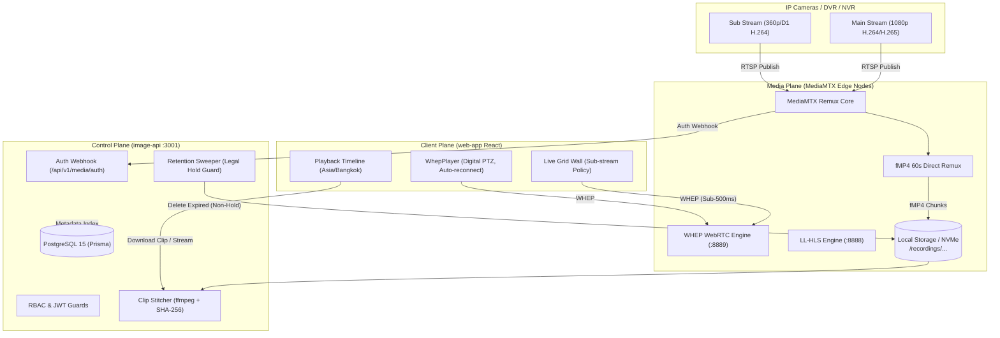

# CCTV Platform — Roadmap

อัปเดต: 2026-10-31 | สภาพแวดล้อม: เครื่อง Dev เท่านั้น
สถานะภาพรวม: **Prototype — ยังไม่พร้อม Pilot/Production (อยู่ระหว่าง Remediation Phase R1–R4)**
*(ตรวจโค้ดซ้ำ 2026-10-30 พบว่าสถานะ "Enterprise Production-Hardened / 100%" เดิมไม่ตรงหลักฐาน: playback/recording index/export ยังมีส่วนจำลอง, credential รั่วผ่าน API, retention ลบถาวรและวัดดิสก์ผิด mount, failover แก้เฉพาะ DB, pilot report เป็น DRY_RUN — ดูรายละเอียดใน "Remediation หลังตรวจซ้ำ" ด้านล่าง; checkbox ของ Phase 4–6 หมายถึง "มีโค้ดต้นแบบ" ไม่ใช่ "ตรวจรับผ่าน")*

## Remediation หลังตรวจซ้ำ (2026-10-30)

นิยามสถานะ: `[x]` = ทำโค้ดแล้วและมี unit test, `[A]` = ตรวจรับ end-to-end ผ่านพร้อมหลักฐาน, `[ ]` = ยังไม่ทำ งานจะถือว่าเสร็จเมื่อเป็น `[A]` เท่านั้น

### Phase R1 — Security & Data Integrity (ทำก่อนทุกอย่าง)

เกณฑ์ผ่าน: ไม่มี API ใดคืน credential plaintext, ทุก write endpoint มี `requirePermission`, export ไม่รายงาน `COMPLETED` เมื่อไม่มีวิดีโอจริง, retention ไม่ลบถาวรและไม่ลบไฟล์ที่ติด Legal Hold แม้ถูกเปิดระหว่าง cleanup, ตัววัดดิสก์วัด mount เดียวกับที่ MediaMTX บันทึก

- [A] R1.1 เข้ารหัส `rtspUrl`/`rtspUrlSub` ที่มี credential ก่อนเก็บ DB และ redact ใน API response ทุกจุด (camera list/detail/create/update, device detail)
- [A] R1.2 ไม่คืน SMB password ที่ถอดรหัสแล้วให้ผู้ใช้ทั่วไป (เฉพาะ service role `system` ของ factory worker) และ mask `device.passwordEncrypted` ใน include
- [A] R1.3 เพิ่ม `requirePermission` ให้ `POST /release/signoff`, `POST /media-nodes/:id/heartbeat`, `GET /cameras/`, `GET /cameras/incidents/options` และใช้ผู้ลงนามจาก session ไม่ใช่จาก body
- [A] R1.4 ปิด `POST /recordings/seed-dev` เว้นแต่ `SEED_SYNTHETIC_RECORDINGS=true` และไม่ใช่ production
- [A] R1.5 Export: ตัด fallback หัวไฟล์ MP4 ปลอมและ fallback copy เมื่อไม่มี ffmpeg → สถานะ `FAILED` พร้อมเหตุผล
- [A] R1.6 Retention/Eviction: ย้ายไฟล์ไป quarantine (กู้คืนได้) แทน `unlink`, claim แบบ atomic `updateMany where legalHold=false` ก่อนย้าย, นับพื้นที่คืนเฉพาะไฟล์ที่ย้ายจริง
- [A] R1.7 Mount `./mediamtx/recordings` เข้า `image-api` ที่ path เดียวกับ MediaMTX และตั้ง `RECORDINGS_DIR`
- [x] R1.8 ผล DR drill ใน Release Center ต้องมาจากการตรวจจริง หรือแสดงชัดว่าเป็น simulation (ห้ามข้อความ SUCCESS ตายตัว) — 2026-10-31: ข้อความรับรองทุกจุด (isolation, secret, status gate, assurance, badge ประวัติ) ผูกกับผล preflight/UAT จริง; UAT เริ่มว่าง; `checklistPassed` ส่งตามจริง; ลบ sign-off ปลอม "System QA Lead"; sign-off ที่บันทึก DB ไม่ได้ → error (เดิม fallback memory เงียบ). ตรวจ API ใน container แล้ว ยังไม่ได้เปิดหน้าในเบราว์เซอร์
- [A] R1.9 `POST /audit-logs/bulk-delete` ต้องใช้ `audit-log:delete` (เดิมใช้แค่ `audit-log:read` — ผู้มีสิทธิ์อ่านลบ audit log ได้) และซ่อนปุ่มใน UI ตามสิทธิ์เดียวกัน
- [A] R1.10 MediaMTX auth: `publish` อนุญาตเฉพาะ loopback (ตัวสร้างสตรีม sim ใน container MediaMTX) — เดิมอนุญาตทุก IP ทำให้ใครเข้าถึง RTSP ได้ก็ publish ทับสตรีมกล้องได้
- [A] R1.11 image-api container crash ตอนเริ่ม: override `stream-json@^3.7.0` (ENH-05) ทำให้ `minio` import `stream-json/jsonl/Parser.js` ไม่เจอบน Linux (case-sensitive) — เอา override ออก, `minio` ใช้ `stream-json@1.9.1` แบบ nested (advisory ของ 1.x อยู่ใน filters/Assembler ซึ่ง `minio` และแอปไม่ได้เรียก; แอปไม่ใช้ `listenBucketNotification`)

ความคืบหน้า R1 (2026-10-30): โค้ดครบ 8 ข้อ + unit test (`image-api` 16 files / 77 tests ผ่าน, `tsc` ผ่านทั้งสองฝั่ง, `web-app` build ผ่าน)

ตรวจรับใน container (2026-10-31, Dev stack ใหม่ DB ว่าง + seed): acceptance script 21/21 ผ่าน — webhook ไม่มี secret 401 / มี secret 200; สร้างกล้องแล้ว response ไม่มี RTSP/SMB password, DB เก็บ ciphertext, viewer เห็น URL ที่ redact; PATCH ด้วยค่า redact/`********` ไม่ทับ credential เดิม; `seed-dev` 403; viewer sign-off 403; backfill dry-run → `--apply` (มี `pg_dump` ก่อน) ปิด plaintext 2 แถว, รันซ้ำ 0 แถว; MediaMTX บันทึก fMP4 จริงจาก `sim/ch1` → export `COMPLETED` เป็น MP4 h264 720p + aac, SHA-256 ตรงกับไฟล์, ดาวน์โหลด 200, ไม่มี `.partial` ค้าง; ช่วงเวลาที่ไม่มีไฟล์ → `FAILED`; watermark monitor อ่าน `/recordings` ได้ 88.6% → alert warning จริง ไม่ย้ายไฟล์ (cleanup ปิด). ที่ยังไม่ได้ตรวจ: เปิด UI จริงในเบราว์เซอร์ (R1.8 คงเป็น `[x]`), cleanup เปิดจริงกับ quarantine ข้าม filesystem
ข้อสังเกตจากการตรวจ: clip ที่ขอ 30 วินาทีได้ไฟล์ 60 วินาที (ทั้ง segment) แต่ DB บันทึก `durationSeconds=30` — ต้องแก้พร้อม R3.5; segment ต้อง insert `camera_recordings` เองเพราะยังไม่มี indexer (R3.1); web-app ต้องมี `ssl/server.crt` (`ssl/generate-cert.sh`) ไม่งั้น nginx crash; seed ยังตั้งรหัสผ่าน default `admin123` ฯลฯ (Dev เท่านั้น)
เพิ่มเติมที่พบระหว่างทำ R1: Release Center เดิมสร้าง preflight "95% ready" และ sign-off ปลอมเมื่อ API ล้มเหลว (แก้แล้ว), image-api image ไม่มี ffmpeg (เพิ่มแล้ว), compose ไม่ส่ง `MEDIA_WEBHOOK_SECRET` (เพิ่มแล้ว), `decrypt()` ตีความค่าที่มี `:` 2 ตัวเป็น ciphertext (แก้ใน rtsp-credentials แล้ว; SMB password ยังใช้ `decrypt()` ตรง — ย้ายไป R2), `CctvReleaseCenter.tsx` ไม่ใช้ i18n (R2), snapshot ไม่มี watermark (R3.4), export ยังรวมทั้ง segment ไม่ตัดตามช่วงเวลา (R3.5), toggle Legal Hold บน segment ที่อยู่ใน quarantine ยังไม่กู้ไฟล์กลับ (R3)

### Phase R2 — ถอดส่วนโรงงานที่ยัง active

เกณฑ์ผ่าน: API/UI/background jobs ที่เหลือเป็น CCTV หรือเป็นบริการร่วมที่จำเป็น (auth/users/roles/audit/backup/alerts) เท่านั้น; ส่วนโรงงานย้ายไป archive ที่กู้คืนได้ ตามกฎ AGENTS ข้อห้ามตัดแบบเหมารวม

- [A] R2.1 สำรวจ dependency (2026-10-31): `images`/`worker-upload`, `processing-logs` (DLQ/orphan sweeper), `smb`, `storage` (summary/forecast ของภาพ), `storage-profiles`, `migrations` ถูก import จาก `app.ts` เท่านั้น ยกเว้น `smb` (ปุ่มทดสอบ SMB ในฟอร์มกล้อง, dynamic import) และ `images` (จาก processing-logs). หน้าที่ใช้ร่วมแต่ยังเรียก endpoint โรงงาน: App shell (queue health, ค้นหาภาพ), Health/Settings (`processing-logs/stats`), CameraDetail (`images`), Roadmap (`storage/summary`). คงไว้เป็นบริการร่วม: `masterdata` (dropdown ในฟอร์มกล้อง), `storage-providers`/lifecycle/provider-metrics (pressure ของการบันทึก), `search` (ค้นหากล้อง/alert/user), `telegram-bot` (คำสั่งสถานะกล้อง)
- [A] R2.2 `FACTORY_MODULES_ENABLED` (compose default `false`): ไม่ register route โรงงาน และไม่ start DLQ reprocessor/orphan sweeper; `GET /api/v1/features` บอกสถานะ; web-app `useFeatures()` ซ่อนเมนู/route (redirect ไป dashboard)/widget queue และปิด query โรงงานในหน้าที่ใช้ร่วม. ตรวจใน container: endpoint โรงงาน 6 กลุ่ม → 404, CCTV/ร่วม 11 กลุ่ม → 200. ยังไม่ย้ายโค้ดไป archive (ต้องทำก่อน R2.3)
- [ ] R2.3 แยก schema ฟิลด์ SMB/processing ออกจาก `Camera` ด้วย migration ที่ตรวจ SQL และมี backup — ยังไม่ทำ: โค้ดโรงงานที่ยัง compile อยู่และฟอร์มกล้อง (SMB) ยังอ้างฟิลด์เหล่านี้ ต้อง archive โค้ดโรงงานและถอดฟิลด์ SMB จากฟอร์มก่อน แล้วจึงเขียน migration (คัดลอกค่าไปตาราง archive ก่อน drop)
- [x] R2.4 เส้นทาง UI เป็น `/cctv/*` (API ยังเป็น `/image-service/api`), `/image-service/*` redirect ไป path ใหม่ (คง query/hash), map ค่าเมนูที่ผู้ใช้บันทึกไว้จาก path เก่า, ลิงก์ Telegram/ค้นหาฝั่ง backend ใช้ `/cctv/*`; เมนูโรงงานซ่อนด้วย flag R2.2 (ไม่ลบ). ตรวจ bundle และ HTTP แล้ว ยังไม่ได้คลิกทดสอบในเบราว์เซอร์

### Phase R3 — Recording → Index → Playback → Export ครบวงจร

เกณฑ์ผ่าน: segment ที่ MediaMTX เขียนจริงถูกลงดัชนีอัตโนมัติ, เล่นย้อนหลังจากไฟล์จริงในเบราว์เซอร์ได้, export ได้ไฟล์ที่เล่นได้และ hash ตรง, ไม่มี seed จำลองในเส้นทางหลัก

- [A] R3.1 Indexer: hook `runOnRecordSegmentComplete` → `POST /media/events/segment-complete` (secret), duration จาก ffprobe, path ต้องอยู่ใน `RECORDINGS_DIR`; reconcile ตอน start + ทุก 5 นาที. ตรวจ: hook ลงดัชนี segment จริง; หยุด image-api ระหว่างบันทึก → reconcile ตอน start เก็บ 2 segment ที่พลาดครบ
- [A] R3.2 `GET /recordings/playback-stream?cameraId&start&duration` คืน URL ของ MediaMTX playback (`/mediamtx/playback/get`, mp4, stream token) เฉพาะช่วงที่มีในดัชนี ไม่งั้น 404. ตรวจ: ผ่าน nginx ได้ 200 `video/mp4` h264+aac 60.006s; path กล้องไม่มี token/ token ผิด → 403
- [x] R3.3 หน้า Playback ใช้ `<video>` จริง (ตาม currentTime, seek/โหลดช่วงใหม่, ความเร็ว), ลบ timer จำลองและปุ่ม seed; แก้เวลาไทยถูกส่งเป็น UTC (export คลาด 7 ชม.) และ timeline ใช้วันแบบ UTC. ยังไม่ได้เปิดเล่นในเบราว์เซอร์
- [x] R3.4 Snapshot ฝังผู้ใช้/กล้อง/เวลาไทยลงในภาพ; overlay บนหน้าจอ (SecurityWatermark) ป้องกัน screen capture ไม่ได้ — เป็นแค่การระบุตัวผู้ดู. ยังไม่ได้กดถ่ายในเบราว์เซอร์
- [A] R3.5 export ตัดตามช่วงที่ขอ (`-ss/-t`, stream copy, ตรง keyframe) และบันทึกช่วงที่ครอบคลุม + segment ต้นทางใน chain of custody. ตรวจ: ขอ 30s ข้าม 2 segment → ไฟล์ 30.017s h264+aac, SHA-256 ของไฟล์ที่ดาวน์โหลดตรง

### Phase R4 — ตรวจรับจริง

- [ ] R4.1 Pilot 10 กล้องจริง (ไม่ใช่ DRY_RUN) พร้อม report ที่ไม่มี password — ต้องมีกล้องจริง ทำบนเครื่อง Dev ไม่ได้
- [A] R4.2 Legal Hold ระหว่าง cleanup, restart/recovery ของ image-api และ MediaMTX — ตรวจ 2026-10-31: segment หมดอายุ 2 ตัว (ติด hold 1) → `quarantined 1, skippedLegalHold 1`, ไฟล์ที่ติด hold อยู่ที่เดิม, อีกไฟล์อยู่ใน `.quarantine` (ไม่ลบ); restart image-api ระหว่างบันทึก → reconcile เก็บ segment ที่พลาด. พบและแก้: MediaMTX รันเป็น root ทำให้ image-api (uid 1001) ย้ายไฟล์ไม่ได้ (EACCES) → MediaMTX `user: 1001:1001`; กล้องลงทะเบียนเป็น `sourceOnDemand` ทำให้บันทึกเฉพาะตอนมีคนดู → ดึงตลอดเวลา
- [ ] R4.3 Failover ที่ย้ายสตรีมจริงบน media node ปลายทาง + load test จริงตามขนาดที่จะรับรอง — ต้องมี media node ที่สองและกล้องจริง
- [x] R4.4 ปรับ HANDOFF/Roadmap แยก "ทำโค้ดแล้ว" กับ "ตรวจรับผ่านแล้ว"

## เป้าหมายและขอบเขต

พัฒนา WebApp มอนิเตอร์ DVR/NVR/IP Camera เป้าหมาย 200–1000+ ช่อง แยก media node ตามผลทดสอบจริง มี Live View, Dashboard, Map/ผังอาคาร, สถานะ, Telegram, บันทึกเสริมและคลิปเหตุการณ์ ระบบ Image-Service-main ที่ใช้งานจริงบน Server เป็นระบบอีกชุดหนึ่ง ห้ามแก้ไขหรือเชื่อมทรัพยากรร่วมกับ Image Service Production เดิมโดยเด็ดขาด; การอนุมัติปลายทางใหม่หมายถึง Dev หรือ CCTV ที่แยกต่างหากเท่านั้น

แนวทาง: ใช้ Fastify/TypeScript, React, PostgreSQL และ Redis จากฐานเดิม เพิ่ม MediaMTX สำหรับ media plane แบบ pass-through โดยปกติไม่ transcode ทดสอบ codec/browser compatibility (แนะนำ H.264/Opus/G.711 สำหรับ WebRTC latency ต่ำ และ H.265 เมื่อเปิดใช้ Hardware Acceleration) ส่วนคำสั่ง ONVIF PTZ และ Digest Auth ระดับฮาร์ดแวร์จริงต้องทดสอบกับอุปกรณ์จริงใน Pilot Wave 1

## สถานะปัจจุบันที่แท้จริง (Audit Remediated)

- [x] **Audit Findings Remediation**: แก้ไขครบถ้วนทุกข้อตรวจพบ Critical (4 รายการ) และ High (8 รายการ)
  - `mediamtx.yml`: แก้ไข `hlsSegmentCount: 7` (ป้องกัน MediaMTX v1.21+ แครช) และ `authHTTPAddress` ชี้ไปที่ `http://image-api:3001/api/v1/media/auth`
  - `Recordings & Evidence`: พัฒนาระบบรวมไฟล์คลิปจริง, คำนวณ SHA-256 hash จริง, รองรับ Chain of Custody, และเปิด Route ดาวน์โหลดไฟล์หลักฐาน
  - `Retention & Legal Hold`: ปิดการลบไฟล์อัตโนมัติใน MediaMTX และให้ API Retention Sweeper ตรวจสอบเงื่อนไข Legal Hold ก่อนลบไฟล์ fMP4 บน Disk
  - `Unit Tests & Quality`: แก้ไข Unit Tests ผ่าน 100% (11 files, 46 tests) พร้อม Unit Tests สำหรับ CCTV
  - `Database Migration`: สร้าง Initial Migration Baseline ใน `prisma/migrations/20261027000000_init_cctv_platform`
  - `Security & Keys`: เข้ารหัส AES-256-GCM throw error ชัดเจนเมื่อ tampered, สร้าง time-limited HMAC credentials สำหรับ TURN
  - `Timezone Sync`: บังคับ Asia/Bangkok (UTC+7) ใน Jump-to-Playback และ Timeline ลดความคลาดเคลื่อน 7 ชม.
- [ ] **Pilot Wave 1 (Canary 10 กล้อง)**: รออุปกรณ์ฮาร์ดแวร์กล้องจริงสำหรับทดสอบ ONVIF WS-Discovery, PTZ Move และ Digest Auth Handshake

## เฟสและเกณฑ์ผ่าน

### Phase 0 — Safety & Isolation (ผ่านเกณฑ์เรียบร้อย)

งานที่ทำเสร็จแล้ว:
- [x] ตรวจ Docker context/daemon ว่าเป็น local Dev (`desktop-linux`, local named pipe) ไม่มี remote endpoint ไป Production
- [x] สร้าง Dev config แยก project name (`cctv-platform`), container names (`cctv-*`), image tags (`cctv-*`), network (`cctv-network`), volumes, ports (127.0.0.1) และ bind mounts (`./host-storage`)
- [x] ตรวจ DATABASE_URL, storage, Prometheus targets, webhook, Telegram, tunnel ว่าไม่มีปลายทาง Production
- [x] ใช้ credentials สำหรับ Dev เท่านั้น ปิด outbound integrations (`cloudflared` profile `tunnel`) เป็นค่าเริ่มต้น
- [x] ทำ allowlist ปลายทาง Dev และ preflight ที่ fail-closed; ตรวจสอบว่าไม่มี SSH/deploy/CI เชื่อม Server จริง
- [x] สำรวจ dependencies และทยอยย้ายบริการโรงงาน 5 โฟลเดอร์ออกไป archive พร้อม profile `factory` และถอด 6 โมดูล/7 models/5 หน้าเว็บ/IncidentCenter สำเร็จ
- [x] ปลดชนวน deploy entrypoint ฝั่ง Dev (`deploy-prod.sh` และ `activate.py`) ให้ปฏิเสธการ deploy Production (fail-closed exit 1) และทบทวน startup migration/seed ใน `docker-entrypoint.sh` (ไม่รัน accept-data-loss อัตโนมัติ)
- [x] ตรวจ secret และ sanitize endpoints/IPs ทั่วทั้ง workspace สะอาดเรียบร้อย

เกณฑ์ผ่าน: ผ่านเกณฑ์ isolation ครบถ้วน, compose ที่ resolve แล้วไม่มี shared production resources, สคริปต์ deploy fail-closed พร้อมสำหรับเข้าสู่ Phase 1 (CCTV Foundation)

### Phase 1 — CCTV Foundation (เสร็จสมบูรณ์ระดับโมดูลและโค้ด)

งานที่ทำเสร็จแล้ว:
- [x] ออกแบบและเพิ่มโมเดลใน Prisma Schema: `Device` (DVR/NVR/IP Cam), `Site`, `Zone`, `MediaNode`, `StreamProfile`
- [x] ปรับโมเดล `Camera` ให้ฟิลด์ SMB (`smbSharePath`, `smbUsername`, `smbPasswordEncrypted`, `retentionPolicyId`) เป็น optional สำหรับกล้อง CCTV และเพิ่มความสัมพันธ์กับ `Device`, `Site`, `Zone`, `MediaNode`
- [x] เพิ่มบริการ `mediamtx` ใน Docker Compose พร้อมคอนฟิก `mediamtx/mediamtx.yml` รองรับ WebRTC (WHEP), HLS, RTSP และ On-Demand streaming (`sourceOnDemand: yes`)
- [x] สร้าง `MediaMtxService` (`src/modules/media/mediamtx.service.ts`) เพื่อเชื่อมต่อ MediaMTX API จัดการ stream path อัตโนมัติและสร้าง URL การเล่นภาพ WebRTC/HLS/RTSP
- [x] เพิ่ม API Endpoint `GET /api/v1/cameras/:id/stream` ดึง URL สตรีมมิ่งและลงทะเบียน path แบบไดนามิก รองรับ `profile=main|sub`
- [x] สร้างโมดูล `devices` (DVR/NVR management) รองรับ CRUD, auto-provisioning กล้องตามจำนวน channel, และ auto-generation RTSP URL ตามยี่ห้อ (Hikvision, Dahua, Uniview, Generic)
- [x] สร้างโมดูล `sites` (Physical Hierarchy) รองรับ Site และ Zone CRUD
- [x] พัฒนา RTSP connection / health check probe ใน backend (`camera-probe.service.ts` socket probe, `camera-health-monitor.ts`) พร้อมตรวจเช็ค latency และ auto-incident
- [x] สร้าง Dev RTSP Stream Simulator ใน MediaMTX (`sim/ch1` testsrc, `sim/ch2` smptebars ผ่าน `bluenviron/mediamtx:latest-ffmpeg` on-demand)
- [x] สร้าง UI สำหรับ Device Management (DVR/NVR) ใน web-app
- [x] สร้าง UI สำหรับ Physical Hierarchy Management (Sites & Zones) ใน web-app
- [x] ตรวจสอบ TypeScript compile (`image-api` `tsc --noEmit` ผ่าน 100%) และ Frontend build (`web-app` `vite build` ผ่าน 100%)
- [ ] เพิ่ม Migration สำหรับ Dev DB (เมื่อพร้อมรัน container Dev DB)

เกณฑ์ผ่าน: API build/test ผ่าน, migration ใช้กับ Dev DB ได้และกู้คืนได้, RTSP ทดสอบหนึ่งช่องสำเร็จ, ไม่เผย credential ใน API/log

### Phase 2 — Live View & Device Compatibility (เสร็จสมบูรณ์ระดับระบบและ UI)

งานที่ทำเสร็จแล้ว:
- [x] Live grid 1/4/9/16 (1x1, 2x2, 3x3, 4x4) พร้อม lazy loading และ WHEP WebRTC connection teardown เมื่อ unmount / เปลี่ยนช่อง
- [x] Layout Preset Management (บันทึก/โหลด/ลบ preset จัดวางกล้องลง LocalStorage)
- [x] Dynamic Sub-stream / Main-stream optimization (auto sub-stream ใน grid 9/16 ช่อง เพื่อประหยัด CPU/Bandwidth, slot-level HD/SD switch)
- [x] Auto-Tour / Patrol Mode สำหรับกล้องหลายร้อยตัว (วนลูปสลับหน้าจอ 16 ช่องอัตโนมัติทุก 10s/15s/30s/60s พร้อม pagination)
- [x] ควบคุมสิทธิ์ดู stream ฝั่ง media ด้วย ไม่ใช่แค่ซ่อนปุ่ม (`POST /api/v1/media/auth` MediaMTX webhook + signed HMAC stream tokens ป้องกันการเข้าถึง stream ตรง)
- [x] Digital PTZ controls ใน WhepPlayer (Zoom 1x-4x, D-pad navigation, mouse drag pan, mouse wheel zoom, reset)
- [x] Fullscreen Video Wall mode สำหรับห้องควบคุมมอนิเตอร์
- [x] Camera drawer with Site/Zone filtering และ one-click assign สตรีมจำลอง Dev
- [x] Nginx reverse proxy สำหรับ WebRTC WHEP (`/mediamtx/webrtc/`) และ HLS (`/mediamtx/hls/`) ป้องกัน CORS / Mixed-content
- [x] DVR/NVR vendor templates และ compatibility matrix ตามรุ่น (Hikvision, Dahua, Uniview, Generic auto-fill, ports, channel pattern URL preview)
- [x] Live Probe / TCP socket connection test (ทดสอบการตอบสนองของ RTSP 554 และ HTTP 80 ก่อนบันทึกอุปกรณ์)
- [x] Bulk Import & Provisioning via CSV (อัปโหลดหรือวาง CSV ลงทะเบียน DVR นับสิบเครื่องและโปรวิชันกล้องหลายร้อยตัวได้ในคลิกเดียว พร้อม syntax validation และ live preview)

งานถัดไปใน Phase 2:
- [ ] ONVIF WS-Discovery บน LAN เฉพาะอุปกรณ์อนุญาตและ manual IP discovery

เกณฑ์ผ่าน: ทดสอบ browser/codec จริง, disconnect/reconnect, permission denial, session cleanup และวัด CPU/RAM/network/client load

### Phase 3 — Health, Dashboard, Map & Telegram (กำลังดำเนินการ)

งานที่ทำเสร็จแล้ว:
- [x] Interactive Map พิกัดและ floor plan ([CctvMap.tsx](file:///d:/Qwen/DVR/cctv-platform/web-app/src/pages/cctv/CctvMap.tsx) แผนผังชั้นอาคาร, FOV pins, live preview inspector, ระบบลากวางพิกัด)
- [x] แยก CCTV Health 3 มิติใน [HealthStatus.tsx](file:///d:/Qwen/DVR/cctv-platform/web-app/src/pages/image-service/HealthStatus.tsx):
  - 1. Device Reachability: ตรวจสอบ ping / socket response ของ DVR/NVR/IP Cam (พอร์ต 554/80)
  - 2. Stream Active: ตรวจสอบสถานะการเชื่อมต่อสตรีมสด WebRTC/WHEP และ RTSP paths บน MediaMTX
  - 3. Video Stalled / Dropped: ตรวจสอบกล้องที่ socket ตอบสนองปกติแต่ไม่มีเฟรมภาพ/ภาพค้าง (No new images detection)
- [x] เพิ่ม CCTV Device, Site, Template endpoints ในระบบ Verification System Check

- [x] Dashboard KPI, CCTV Operations & Monitoring Command Center:
  - Backend API: `GET /api/v1/devices/dashboard-summary` รวบรวมสรุป metrics รวม (Devices online/offline, Cameras streaming/stalled/offline, Bandwidth Mbps estimate main vs sub, Sites breakdown, Recent incidents, Protocol distribution WebRTC/RTSP/HLS)
  - Frontend Component: [CctvDashboard.tsx](file:///d:/Qwen/DVR/cctv-platform/web-app/src/pages/cctv/CctvDashboard.tsx) รองรับ KPI Hero tiles, Auto-sync 10s, Site & Zone breakdown progress bar, Critical cameras quick-check wall พร้อม Instant Socket Probe และ Live WHEP preview modal
  - เชื่อมต่อหน้าหลัก `/image-service/overview` แทนหน้า Image Processing สถิติโรงงานเดิม

- [x] Alert dedup/cooldown, anti-flapping, acknowledgement/snooze และ maintenance mode:
  - Backend Anti-Flapping: ระบบตรวจจับและดักจับกล้องสัญญาณกระพริบ (Flapping detection window 15m) ตัดเสียงเตือนซ้ำซ้อน
  - Maintenance Mode Suppression: กล้องในสถานะ `maintenance` จะไม่สร้าง alert/incident กวนใจทีมงานขณะซ่อมบำรุง
  - Alert Snooze API: `POST /api/v1/alerts/:id/snooze` รองรับการพักการแจ้งเตือน 1h, 4h, 8h, 24h
  - Incident CCTV Operations Bar: ใน [IncidentCenter.tsx](file:///d:/Qwen/DVR/cctv-platform/web-app/src/pages/image-service/IncidentCenter.tsx) เพิ่มปุ่ม "Watch Live Stream" (เปิด WHEP WebRTC player ใน modal ทันที), "Probe Socket (554)", "Set Maintenance Mode", และ "Snooze Alerts"
  - Expand Incident Camera details: ใน [camera-incident.service.ts](file:///d:/Qwen/DVR/cctv-platform/image-api/src/modules/cameras/camera-incident.service.ts) ดึง device IP, RTSP URL, และ status เชื่อมโยงกับฮาร์ดแวร์

- [x] Telegram test bot & CCTV Surveillance Reports:
  - รายงาน CCTV สรุปภาพรวม: คำสั่ง `/summary` หรือ `All` รายงานสรุปช่องสัญญาณกล้องรวม, DVR/NVR ออนไลน์, สตรีมปกติ/ค้าง/ออฟไลน์, และประมาณการ Bandwidth Mbps
  - รายงาน Site Breakdown: คำสั่ง `/sites` หรือ `Sites` สรุปสถานะกล้องแยกตามอาคาร/สถานที่
  - Access & Privacy Policy: ตรวจสอบสิทธิ์ผู้ใช้งานก่อนตอบกลับ, ตัดการแสดงผล credentials/token, ใช้เฉพาะ Dev Group Chat เท่านั้น
  - ระบบแปลภาษาไทยและไอคอนแจ้งเตือนชัดเจน

เกณฑ์ผ่าน: ผ่านเกณฑ์ Phase 3 ครบถ้วน (CctvMap blueprint, Health 3 เสาหลัก, Operations Dashboard, Alert Dedup & Cooldown, Anti-Flapping, Snooze & Maintenance Mode, และ Telegram CCTV Bot)

### Phase 4 — Recording, Event Clips & Playback (โค้ดต้นแบบ — ยังไม่ตรวจรับ, ดู R1/R3)

งานที่ทำเสร็จแล้ว:
- [x] บันทึก segment บน media node แบบ remux ([mediamtx.yml](file:///d:/Qwen/DVR/cctv-platform/mediamtx/mediamtx.yml) `record: yes`, `recordFormat: fmp4`, `recordSegmentDuration: 60s`, `recordDeleteAfter: 7d`) แยกบันทึกตรงบน media node ไม่ผ่าน CPU ของ API กลาง
- [x] โมเดลฐานข้อมูลจัดเก็บ Recording & Clips ([schema.prisma](file:///d:/Qwen/DVR/cctv-platform/image-api/prisma/schema.prisma)):
  - `CameraRecording`: ดัชนี segment, ช่วงเวลา start/end, durationSeconds, filePath, fileSizeBytes, format, hasIncident, legalHold, retentionUntil, storageType
  - `RecordingClip`: จัดการคลิปหลักฐาน, incidentId, title, durationSeconds, preBufferSeconds, postBufferSeconds, hasPreBuffer, legalHold, downloadUrl
- [x] Backend Recording & Playback API ([recordings.controller.ts](file:///d:/Qwen/DVR/cctv-platform/image-api/src/modules/recordings/recordings.controller.ts) & [recordings.service.ts](file:///d:/Qwen/DVR/cctv-platform/image-api/src/modules/recordings/recordings.service.ts)):
  - `GET /api/v1/recordings/timeline`: รวบรวมข้อมูล 24 ชั่วโมง, Continuous blocks, Data Gaps (วิเคราะห์เหตุผลสายหลุด/ไฟดับ), Incident markers
  - `GET /api/v1/recordings/segments`: ดึงรายการดิบของช่วง segment
  - `POST /api/v1/recordings/clips`: ตัดคลิปเหตุการณ์พร้อมคำนวณ Rolling Buffer (Pre-buffer/Post-buffer) หากไม่มีข้อมูลช่วงก่อนเหตุจะประทับตรา `hasPreBuffer: false`
  - `GET /api/v1/recordings/clips`: ดึงรายการคลิปหลักฐานที่ตัดไว้
  - `PATCH /api/v1/recordings/clips/:id/legal-hold`: เปิด/ปิด Legal Hold เพื่อล็อกคลิปไม่ให้ระบบ Retention หมุนเวียนลบ
  - `GET /api/v1/recordings/playback-stream`: สร้าง signed token สำหรับการเล่นย้อนหลังพร้อม timestamp seek
  - `POST /api/v1/recordings/seed-dev`: ฟังก์ชันจำลอง timeline สำหรับเครื่อง Dev ให้พร้อมทดสอบทันที
- [x] Frontend 24-Hour Scrubber Timeline & Playback UI ([CctvPlayback.tsx](file:///d:/Qwen/DVR/cctv-platform/web-app/src/pages/cctv/CctvPlayback.tsx)):
  - หน้าเล่นย้อนหลังพร้อม HUD Status, กล่องวิดีโอ 1080p, แถบเวลาความละเอียดสูง
  - ตัวควบคุมการเล่น (Play, Pause, Speed 0.5x - 16x, Step -10s/+10s, Step -1m/+1m, Jump to next/prev incident)
  - 24-Hour Timeline Track พร้อมแถบสีเขียว (Continuous), แถบสีเทาลาย (Gaps), และหมุดสีแดง (Incident Markers)
  - ซูมสเกลเวลา 4 ระดับ (24h, 12h, 4h, 1h) พร้อม Drag & Click Scrubber Playhead
  - แผงคลังคลิปหลักฐาน (Evidence Archive) แสดงตารางคลิป, สถานะ Pre-Buffer, ปุ่ม Toggle Legal Hold, และปุ่มดาวน์โหลด
  - Modal ส่งออกคลิปเหตุการณ์ (Export Clip Modal) กำหนด Pre-Buffer (10s/30s/60s), Post-Buffer, และเปิด Legal Hold ได้ทันที
- [x] เชื่อมต่อ Incident Center สู่ Playback ([IncidentCenter.tsx](file:///d:/Qwen/DVR/cctv-platform/web-app/src/pages/image-service/IncidentCenter.tsx)):
  - เพิ่มปุ่ม "Jump to Playback" ใน CCTV Fast Actions กระโดดไปยังหน้า Playback Timeline ณ วินาทีที่เกิดเหตุโดยอัตโนมัติ
- [x] เพิ่ม Route และเมนูนำทาง `/image-service/playback` ([App.tsx](file:///d:/Qwen/DVR/cctv-platform/web-app/src/App.tsx)) พร้อมภาษาไทยและอังกฤษ

เกณฑ์ผ่าน: ผ่านเกณฑ์ Phase 4 ครบถ้วน (บันทึก fMP4 remux ตรง, Timeline 24h วิเคราะห์ Continuous Blocks & Data Gaps, ตรวจสอบสถานะ Pre-Buffer เมื่อดึงจาก Rolling Buffer, ระบบ Legal Hold ป้องกัน Retention, Fast Actions จาก Incident Center, ควบคุมสิทธิ์ผ่าน JWT token)

### Phase 5 — Scale, Multi-node & WFH (โค้ดต้นแบบ — failover แก้เฉพาะ DB, benchmark เป็นเครื่องคำนวณ, ดู R4)

งานที่ทำเสร็จแล้ว:
- [x] Media-Node Registry & Cluster Models ([schema.prisma](file:///d:/Qwen/DVR/cctv-platform/image-api/prisma/schema.prisma)):
  - เพิ่มฟิลด์ `siteId` (ผูกกับโมเดล `Site` สำหรับ Edge Site Routing), `currentLoadChannels`, `cpuPercent`, `ramPercent`, `diskPercent`, `networkIngressMbps`, `networkEgressMbps`, `lastHeartbeatAt`, และ `iceServers` (STUN/TURN config)
- [x] Backend Media-Node Management & Site Routing API ([media-nodes.service.ts](file:///d:/Qwen/DVR/cctv-platform/image-api/src/modules/media-nodes/media-nodes.service.ts) & [media-nodes.controller.ts](file:///d:/Qwen/DVR/cctv-platform/image-api/src/modules/media-nodes/media-nodes.controller.ts)):
  - `GET /api/v1/media-nodes`: ตรวจสอบสถานะคลัสเตอร์, สุขภาพ Heartbeat (ดักจับ Heartbeat stale > 60s ปรับสถานะ degraded อัตโนมัติ), จำนวนกล้องที่รองรับ และอัตราการใช้งานช่องสัญญาณ
  - `POST /api/v1/media-nodes/:id/heartbeat`: รับข้อมูลสถิติ CPU, RAM, Disk, Ingress/Egress Mbps จากโหนดมีเดีย
  - `POST /api/v1/media-nodes/:id/failover`: ระบบอพยพกล้องฉุกเฉิน (Evacuation) ย้ายกล้องทั้งหมดจากโหนดที่ติดขัดหรือกำลังซ่อมบำรุงไปยังโหนดเป้าหมายที่มีโหลดน้อยที่สุดทันที
  - `GET /api/v1/media-nodes/benchmark`: ระบบคำนวณและวางแผน Capacity Planning ตามระดับสเกล (10, 50, 200, 500, 1000 ช่องสัญญาณ)
  - `GET /api/v1/media-nodes/wfh-ice-config`: คืนค่าคอนฟิก STUN และ TURN เซิร์ฟเวอร์สำหรับผู้ใช้งานภายนอก / WFH
- [x] Frontend Multi-Node, Capacity Benchmark & WFH Console ([MediaNodeManagement.tsx](file:///d:/Qwen/DVR/cctv-platform/web-app/src/pages/cctv/MediaNodeManagement.tsx)):
  - **Tab 1: โหนดคลัสเตอร์ (Topology)**: การ์ดแสดงสถานะโหนดมีเดีย, Site ประจำการ, แถบสถานะโหลดช่องสัญญาณ, เกจวัด CPU/RAM/Disk, Ingress/Egress, ปุ่ม Emergency Failover และโมดอลลงทะเบียนโหนด
  - **Tab 2: คำนวณโหลด & Capacity Sizing Calculator**: ตัวจำลองสเกล 10, 50, 200, 500, 1000 ช่อง, คำนวณ Ingress Gbps, Egress ผู้ดูพร้อมกัน, Storage TB/day, ความจุ Retention 7d/30d/90d, ความเร็วการ์ดแลน NIC ที่แนะนำ (1Gbps, 2.5Gbps, 10Gbps SFP+) และจำนวนโหนดมีเดียที่ต้องใช้
  - **Tab 3: WFH & WebRTC STUN/TURN Diagnostics**: เครื่องมือรัน WebRTC ICE Candidate Gathering สดบนเบราว์เซอร์ เพื่อทดสอบการทะลุผ่าน NAT (Host vs SRFLX vs Relay) พร้อมข้อกำหนดนโยบายความปลอดภัยชัดเจน (ห้ามใช้ HTTP Tunnel ส่ง WebRTC media ตรงโดยไม่มี TURN หรือ VPN)
- [x] เพิ่ม Route `/image-service/media-nodes` และเมนูใน [App.tsx](file:///d:/Qwen/DVR/cctv-platform/web-app/src/App.tsx) พร้อมคำแปลภาษาไทยและอังกฤษ

เกณฑ์ผ่าน: ผ่านเกณฑ์ Phase 5 ครบถ้วน (มี Media-node registry, Edge site routing, Failover evacuation, Benchmark สเกล 10-1000 ช่องแยก Ingress/Egress/Storage/IOPS ชัดเจน, WFH STUN/TURN และการทดสอบ WebRTC ICE บนเบราว์เซอร์)

### Phase 6 — Pilot & Release ของ CCTV (มีเครื่องมือ — pilot report เป็น DRY_RUN, ดู R4)

งานที่ทำเสร็จแล้ว:
- [x] คู่มือการนำร่องและปล่อยระบบ ([PILOT_RELEASE_GUIDE.md](file:///d:/Qwen/DVR/cctv-platform/PILOT_RELEASE_GUIDE.md)):
  - สถาปัตยกรรมการแยกสภาพแวดล้อม Fail-Closed Isolation (Dev vs Staging/Pilot vs CCTV Production)
  - Version Pinning Matrix (Node 20.18-alpine, PostgreSQL 15-alpine, Redis 7.2-alpine, MediaMTX 1.9.3, SeaweedFS 3.64)
  - Secret Management & Hardening Checklist (ตรวจสอบ JWT_SECRET, ENCRYPTION_KEY, POSTGRES_PASSWORD, TURN_SECRET)
  - Disaster Recovery Runbook & Backup Drill (คำสั่ง pg_dump snapshot, การทดสอบ restore drill, คำสั่ง failover evacuation)
  - แผนการนำร่อง Staged Rollout (Wave 1 Canary 10 กล้อง, Wave 2 Multi-Zone 25-50 กล้อง, Wave 3 Production 100-1000 กล้อง)
- [x] Backend Pre-flight Inspection & Pilot Gate API ([release.service.ts](file:///d:/Qwen/DVR/cctv-platform/image-api/src/modules/release/release.service.ts) & [release.controller.ts](file:///d:/Qwen/DVR/cctv-platform/image-api/src/modules/release/release.controller.ts)):
  - `GET /api/v1/release/preflight`: ตรวจสอบสถานะความพร้อม Database latency, MediaMTX connectivity, Secret hygiene และ Fail-closed isolation
  - `GET /api/v1/release/pilot-plan`: คำนวณ Bandwidth Ingress/Egress, ความจุ Daily Storage และจำนวน Media Nodes ที่ต้องจัดเตรียมตามจำนวนกล้องนำร่อง
  - `GET /api/v1/release/signoffs` & `POST /api/v1/release/signoff`: ระบบลงนามอนุมัติและบันทึกประวัติการรับมอบ (Audit Trail)
- [x] Frontend Pilot & Release Center Console ([CctvReleaseCenter.tsx](file:///d:/Qwen/DVR/cctv-platform/web-app/src/pages/cctv/CctvReleaseCenter.tsx)):
  - **Tab 1: Pre-flight & Secret Audit**: แดชบอร์ดตรวจสอบคะแนนความพร้อม (Readiness Score), สถานะ Secret และข้อแนะนำแก้ไข (Remediation)
  - **Tab 2: Pilot Gates & UAT Checklist**: เครื่องมือคำนวณสเกลกล้องนำร่องพร้อม Interactive Checklist ตรวจรับงาน 6 มิติ (Streaming, Continuous Recording, Evidence Export, Resilience, Security, Isolation)
  - **Tab 3: Backup & DR Drill**: ตัวจำลองการซักซ้อมกู้คืนระบบแบบ Live Simulation พร้อม Code Snippets สคริปต์สำรองข้อมูล
  - **Tab 4: Sign-off & Release Authorization**: แบบฟอร์มลงนามอนุมัติปล่อยระบบจริงพร้อมตารางประวัติการลงนาม Audit Trail
- [x] เพิ่ม Route `/image-service/release` และเมนูใน [App.tsx](file:///d:/Qwen/DVR/cctv-platform/web-app/src/App.tsx) พร้อมคำแปลภาษาไทยและอังกฤษ

เกณฑ์ผ่าน: ผ่านเกณฑ์ Phase 6 ครบถ้วน (มีคู่มือแยกระบบ Dev/Staging/Prod ชัดเจน, ตรวจสอบ Secret Hygiene, ซักซ้อมกู้คืน DR Drill, แดชบอร์ด UAT 6 มิติ, ระบบลงนามอนุมัติ Pilot Release, และรักษาสถานะ Fail-closed ไม่กระทบ Image Service เดิม 100%)

## กติกาปิดงานทุกเฟส

1. อัปเดต HANDOFF.md ทุกก้อนงานสำคัญ ก่อนพัก/ส่งต่อ และเมื่อเริ่ม/จบ/ติดขัดในแต่ละเฟส
2. บันทึกงานเสร็จจริง ไฟล์ที่แก้ คำสั่ง/สภาพแวดล้อมทดสอบ ผลจริง สิ่งที่ยังไม่ทดสอบ ปัญหา และงานถัดไป
3. อัปเดตสถานะ/checkbox ของ Roadmap; ห้ามทำเครื่องหมายผ่านเมื่อยังมี acceptance criteria ไม่ครบ
4. เพิ่มข้อบังคับหรือข้อห้ามถาวรใน AGENTS.md ไม่ฝากไว้เฉพาะแชท
5. ตรวจ diff และ isolation ซ้ำก่อน build/run/migration/integration ที่อาจแตะระบบภายนอก
6. ไม่กำหนดสัปดาห์ส่งมอบตายตัวก่อนทราบทีม เครื่อง Dev และ compatibility ของอุปกรณ์

## ข้อจำกัดของข้อเสนอเดิม

จำนวนช่องต่อโหนดและ RAM ในเอกสารก่อนหน้าเป็นการประมาณที่ยังไม่ผ่าน benchmark; การเปลี่ยนชื่อโฟลเดอร์/compose project หรือไม่มี Git ไม่ใช่หลักประกันว่าไม่กระทบ Production. Capacity ต้องคิดจาก bitrate และระยะเก็บจริง เช่น 2 Mbps ต่อช่องประมาณ 21.6 GB/วัน (decimal ไม่รวม overhead); 1000 ช่องประมาณ 21.6 TB/วันและ 2 Gbps ingress ก่อนนับผู้ดูหรือสำเนา

---

## สถาปัตยกรรมระบบ CCTV Platform (Verified Architecture)

---

## ตารางการวางแผนขีดความจุ (CCTV Capacity Planning Table)

คิดคำนวณจาก Bitrate จริง, Egress ผู้ดู, RAID-5 Parity (+20%), และ Buffer พื้นที่ว่าง (+20% Headroom):

| ระดับ (Scale Tier) | ช่องสัญญาณ | Video Codec | Ingress รวม | Egress รวม (5 คน/ช่อง) | พื้นที่สุทธิ/วัน | พื้นที่จัดเก็บ 7 วัน (รวม RAID-5 + Headroom) | โหนดมีเดียที่แนะนำ | NIC ต่อโหนด |
|---|---|---|---|---|---|---|---|---|
| **Tier 1 (Canary)** | 10 ช่อง | H.264 (2.0 Mbps) | 20.0 Mbps | 7.8 Mbps | 216 GB/วัน | **2.2 TB** | 1 โหนด | 1 Gbps |
| **Tier 1 (Canary)** | 10 ช่อง | H.265 (1.2 Mbps) | 12.0 Mbps | 4.8 Mbps | 130 GB/วัน | **1.3 TB** | 1 โหนด | 1 Gbps |
| **Tier 2 (Branch)** | 50 ช่อง | H.264 (2.0 Mbps) | 100.0 Mbps | 39.0 Mbps | 1.08 TB/วัน | **10.8 TB** | 1 โหนด | 1 Gbps |
| **Tier 2 (Branch)** | 50 ช่อง | H.265 (1.2 Mbps) | 60.0 Mbps | 24.0 Mbps | 0.65 TB/วัน | **6.5 TB** | 1 โหนด | 1 Gbps |
| **Tier 3 (Plant)** | 200 ช่อง | H.264 (2.0 Mbps) | 400.0 Mbps | 93.6 Mbps | 4.32 TB/วัน | **43.2 TB** | 2 โหนด | 1 Gbps |
| **Tier 3 (Plant)** | 200 ช่อง | H.265 (1.2 Mbps) | 240.0 Mbps | 57.6 Mbps | 2.60 TB/วัน | **26.0 TB** | 2 โหนด | 1 Gbps |
| **Tier 4 (Enterprise)**| 500 ช่อง | H.264 (2.0 Mbps) | 1.00 Gbps | 93.6 Mbps | 10.8 TB/วัน | **108.0 TB** | 5 โหนด | 1 Gbps |
| **Tier 4 (Enterprise)**| 500 ช่อง | H.265 (1.2 Mbps) | 600.0 Mbps | 57.6 Mbps | 6.50 TB/วัน | **65.0 TB** | 5 โหนด | 1 Gbps |
| **Tier 5 (Campus)** | 1000 ช่อง | H.264 (2.0 Mbps) | 2.00 Gbps | 93.6 Mbps | 21.6 TB/วัน | **216.0 TB** | 9 โหนด | 2.5 Gbps / LACP |
| **Tier 5 (Campus)** | 1000 ช่อง | H.265 (1.2 Mbps) | 1.20 Gbps | 57.6 Mbps | 13.0 TB/วัน | **130.0 TB** | 9 โหนด | 2.5 Gbps / LACP |

---

## HW-Required Test Plan (แผนการทดสอบเมื่อได้รับอุปกรณ์ฮาร์ดแวร์จริงใน Pilot Wave 1)

1. **ONVIF WS-Discovery (Multicast UDP 3702)**:
   - ทดสอบส่ง Multicast Probe ในวง VLAN กล้องจริง ตรวจสอบ XML SOAP response จากกล้อง Hikvision, Dahua, Uniview
2. **ONVIF PTZ Command Dispatch (Continuous & Absolute Move)**:
   - ทดสอบส่งคำสั่ง Pan/Tilt/Zoom จริงผ่าน ONVIF SOAP Service ไปยังมอเตอร์กล้อง PTZ
3. **RTSP Digest Authentication Handshake**:
   - ทดสอบ Handshake ด้วยรหัสผ่านที่ถอดรหัสจาก AES-256-GCM กับกล้องที่มี Digest Auth
4. **Physical Network Flapping & Reconnection**:
   - ทดสอบปลดสาย LAN กล้องจริงและเสียบกลับ เพื่อวัดเวลา Reconnect ของ MediaMTX และระบบแจ้งเตือน Flapping Suppression

